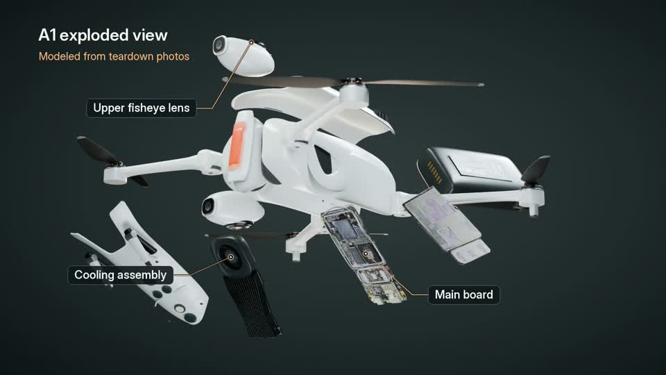

# Inside the Antigravity A1

An animated Blender reconstruction of the Antigravity A1, the 8K 360° camera drone. The scene starts at the two black windows on the nose, rotates to the upper and lower fisheye lenses, then opens the belly to reveal the cooling fan, heat sink and main board.

[Download the Blender project (3.74 MB)](https://github.com/yonghu92/antigravity-a1-blender/raw/refs/heads/main/Antigravity_A1_Model_Study.blend) · [Watch the 58-second English film on YouTube](https://youtu.be/bzc9GGmzmGE)

## Explore the model

Open the file in Blender 5.2 LTS. The project includes the materials, packed textures, studio lighting, ten animated camera setups and 1,401 frames at 24 fps. Frame 1 shows the assembled airframe. Jump to frame 670 for the extended landing gear, frame 1,040 for the thermal pads or frame 1,370 for the exploded view. Press Numpad 0 to look through the active camera.

## Modeling references

The proportions and visible surfaces were reconstructed from product photographs, the user manual and certification teardown photographs. Wall thicknesses and obscured details are approximate. Parts move farther apart in the animation so their shapes and positions are easier to see.

- The manufacturer's specifications and press images supplied exterior dimensions, silhouettes and lens positions. [Antigravity A1 specifications](https://www.antigravity.tech/us/drone/antigravity-a1/specs) · [Product photographs](https://newsroom.notified.com/transcontinentagroup/presskits/46315/new-antigravity-a1-is-the-worlds-first-8k-360-degree-drone)
- The fan housing, fins, shielding, thermal pads and board surfaces were matched to the photos filed for FCC ID 2BO5J-DE001. Some surface textures are derived from those photographs. [FCC internal photos, exhibit 8736401](https://fccid.io/2BO5J-DE001/Internal-Photos/Internal-Photos-8736401)
- Studio lighting includes Poly Haven's CC0 environment map. [Studio Small 03](https://polyhaven.com/a/studio_small_03)

This is an independently made visual study. Product names, logos and source photographs belong to their respective owners.
